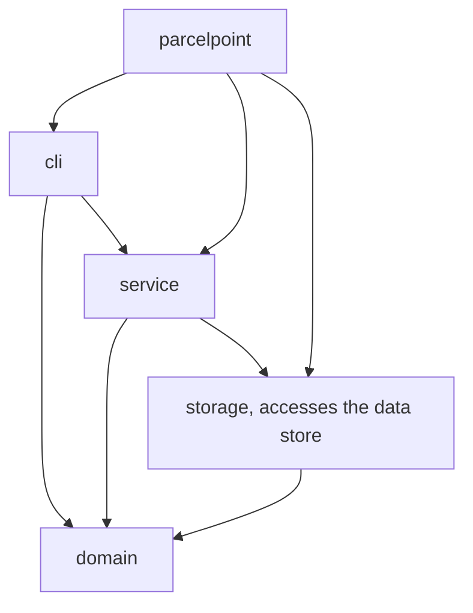
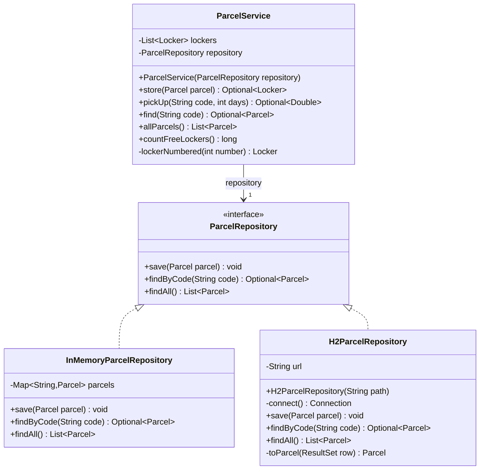
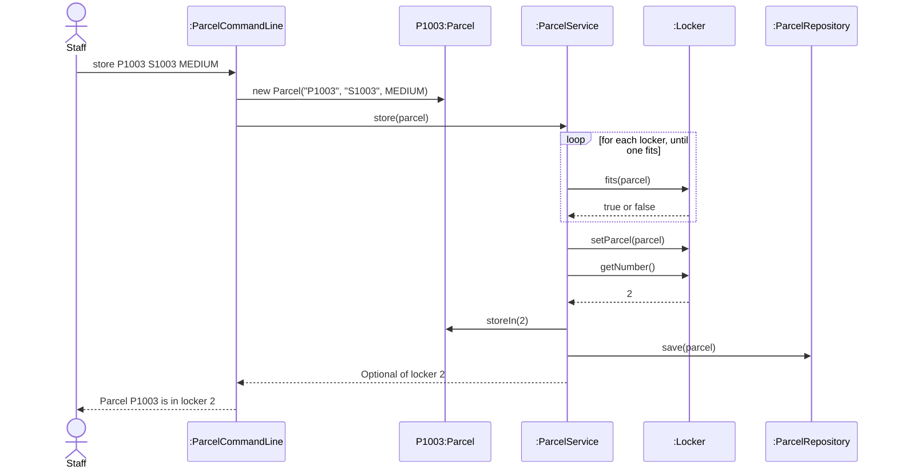

# Lab Report, Designing the Data Management Layer with H2

Repository URL: https://github.com/Nutchuda/itcs382-h2-lab.git

## Tools

| Item | Version or name |
| --- | --- |
| JDK | 27.0.1.0.3|
| Maven | 3.9.16|
| IDE | IntelliJ IDEA |
| AI tool and exact model, if you used one | Claude Opus 5.5 (claude-opus-5-5) |

## Part 0. From a store in memory to H2

Commit of the starter, before any change: bb72857

0.3 Your prediction for `staff`, written before the second run: I think both parcels will still show.

Output of the second run, for `staff` and `quit`:

```text
> staff
Free lockers: 3
> quit
```

State in one sentence where you think the parcels of the first run were kept.

The parcels of the first run were kept only in the memory of the running program, in a Java object, so they disappeared when the program ended.

0.5 The line of Main that you would change to keep the parcels somewhere else:

```java
ParcelRepository repository = new InMemoryParcelRepository();
```

0.6 Commit of the switch to H2: c38de87

0.7 Output of `SELECT * FROM PARCEL;` after you stored two parcels:

```text
sql> SELECT * FROM PARCEL;
CODE  | STUDENT_ID | PARCEL_SIZE | STATUS | LOCKER_NUMBER
P1001 | S1001      | SMALL       | STORED | 1
P1002 | S1002      | LARGE       | STORED | 3
(2 rows, 17 ms)
```

0.8 Explain why ParcelPoint could not start while the H2 Shell was open, and identify the class that wrote the message `Cannot create the PARCEL table`.

ParcelPoint could not start because the H2 Shell still had the database file parcelpoint.mv.db open. H2 is an embedded database that runs inside the program that opens it, so it locks the file, and a second program cannot open the same database at the same time (`Caused by: ... Database may be already in use` and `The file is locked`). The message `Cannot create the PARCEL table` was written by the class H2ParcelRepository, in its constructor (H2ParcelRepository.java:36), which catches the SQLException from connect() and throws it again as an IllegalStateException with that message.

0.9 Explain why `staff` shows no parcel while `find` shows each one, and why all three lockers look free.

`find` calls findByCode, which really runs `SELECT * FROM PARCEL WHERE CODE = ?` on H2, so it finds each parcel. `staff` calls findAll through ParcelService.allParcels(), but findAll in H2ParcelRepository is still a TODO that returns an empty list (`List.of()`) without reading the database, so staff has no parcel to show. All three lockers look free because the lockers of ParcelService live only in memory and are filled again in its constructor from `repository.findAll()`; since findAll returns nothing, no waiting parcel is put back into a locker when the program starts, and countFreeLockers counts 3.

0.11 Your findAll method:

```java
    @Override
    public List<Parcel> findAll() {
        String sql = "SELECT * FROM PARCEL ORDER BY CODE";
        List<Parcel> parcels = new ArrayList<>();
        try (Connection connection = connect();
             PreparedStatement statement = connection.prepareStatement(sql);
             ResultSet row = statement.executeQuery()) {
            while (row.next()) {
                parcels.add(toParcel(row));
            }
        } catch (SQLException e) {
            throw new IllegalStateException("Cannot read the parcels", e);
        }
        return parcels;
    }
```

Commit that adds findAll: 9988b8f

0.12 Output of `SELECT * FROM PARCEL;` after the pickup:

```text
sql> SELECT * FROM PARCEL;
CODE  | STUDENT_ID | PARCEL_SIZE | STATUS    | LOCKER_NUMBER
P1001 | S1001      | SMALL       | PICKED_UP | null
P1002 | S1002      | LARGE       | STORED    | 3
(2 rows, 16 ms)
```

0.13 Optional. Describe what `find P9999'OR'1'='1` showed while the SQL was joined from strings, and what it showed after you put the placeholder back.

While the SQL was joined from strings, `find P9999` showed `No parcel with code P9999`, but `find P9999'OR'1'='1` showed `P1001, S1001, SMALL, PICKED_UP`, a real parcel, although no parcel has that code. The quotes that I typed closed the text in the SQL, so H2 ran `SELECT * FROM PARCEL WHERE CODE = 'P9999'OR'1'='1'`; the condition `'1'='1'` is true for every row, so the query returned all rows and findByCode showed the first one. This is SQL injection. After I put the `?` placeholder and `statement.setString(1, code)` back, `find P9999'OR'1'='1` showed `No parcel with code P9999'OR'1'='1`, because H2 compared CODE with the whole text as one value and no row matched.

## Part A. Model the design

A1 Complete the flowchart with one node for each package and one arrow for each dependency, from the package that uses to the package that is used. Mark the package that accesses the data store.



State whether cli depends on storage, and explain why.

No, cli does not depend on storage. ParcelCommandLine imports only classes of domain (Locker, Parcel, ParcelSize) and of service (ParcelService), and it reaches the parcels only through ParcelService. This follows the layered architecture: the presentation layer (cli) talks only to the business layer (service and domain), and only the business layer uses the data management layer (storage) through the interface ParcelRepository, so the data store can change without any change to cli.

A2 Complete the class diagram of the data management layer with ParcelService, the interface ParcelRepository with its three operations, and the two classes that implement it.



A3 Draw a sequence diagram for the command `store P1003 S1003 MEDIUM`, from the staff member to the repository. Show each message as an operation of the class that receives it.



Explain why the last lifeline is the interface ParcelRepository rather than H2ParcelRepository.

The sequence diagram follows the code, and ParcelService calls save on its field repository, whose type is the interface ParcelRepository; the code of ParcelService never names H2ParcelRepository. Which class stands behind the interface is decided only by Main at run time (InMemoryParcelRepository before Step 0.6, H2ParcelRepository after it). This is the Dependency Inversion Principle, so the same diagram stays correct whichever data store Main chooses.

## Part B. Design questions

1. Identify the files that you changed to move from the store in memory to H2, and explain why no other class had to change. Use the terms of this course.

To switch the data store I changed only Main.java, two lines: the import and the line that creates the repository (`new H2ParcelRepository("./data/parcelpoint")` instead of `new InMemoryParcelRepository()`). I also completed findAll in H2ParcelRepository.java, which stays inside the data management layer. No other class had to change because ParcelService and ParcelCommandLine depend on the abstraction ParcelRepository, not on a concrete class (Dependency Inversion Principle), and ParcelService receives its repository through its constructor (dependency injection), so Main is the one place that names the concrete store. The interface hides how the parcels are stored (information hiding), which keeps the coupling between the business layer and the data store low.

2. The PARCEL table stores the size of a parcel as SMALL, MEDIUM or LARGE rather than as 1, 2 or 3. Identify the type of connascence between ParcelSize and the table in each case, and explain which one is weaker.

Storing SMALL, MEDIUM or LARGE gives connascence of name: save writes `getSize().name()` and toParcel reads it back with `ParcelSize.valueOf`, so the table and the enumeration only have to agree on the names of the sizes. Storing 1, 2 or 3 gives connascence of convention, because both sides must agree that 1 stands for SMALL, 2 for MEDIUM and 3 for LARGE; if the numbers came from `ordinal()`, it would even be connascence of position, since reordering the constants of ParcelSize would silently change the meaning of every stored row. Connascence of name is the weaker one: the rows are readable in the H2 Shell, adding or reordering constants does not break the data, and a renamed constant fails loudly in valueOf instead of giving a wrong size.

3. Project Phase 2 asks for a data store that needs no separate server. Explain why an embedded database such as H2 meets this rule, and describe the limit of an embedded database that Step 0.8 showed.

H2 is a Java library that runs inside the program itself, from the single jar h2-2.5.252.jar that Maven copies into target/lib, and it keeps the data in a file (data/parcelpoint.mv.db). Nothing has to be installed or started before the program, and the table is created on the first run by `CREATE TABLE IF NOT EXISTS`. Step 0.8 showed its limit: the database belongs to the one program that opened it, so H2 locks the file, and while the H2 Shell had it open, ParcelPoint could not open it (`Database may be already in use`). An embedded database therefore allows only one program at a time, with no access from several programs or users at once.

4. State the data store that you would choose for your Project Phase 2 team, files or an embedded database, the requirement that drives the choice, and the package that will access it.

Our team would choose an embedded database, H2, for the Gemini Observatory Control System. The requirement that drives the choice is that the data of our use cases must stay after the program ends while needing no separate server and at most one external library; H2 meets this with one dependency in pom.xml and a table created on the first run with CREATE TABLE IF NOT EXISTS, and SQL lets us search and update records by key (MERGE, WHERE) instead of rewriting whole files. Only the data management layer package (storage) will access the database, through repository interfaces, and Main will create the H2 repositories, so the business and presentation layers stay independent of the data store.

## AI usage declaration

| AI tool and exact model | Date | Purpose | Files or answers it produced or changed | How you checked its output |
| --- | --- | --- | --- | --- |
| Claude Opus 5.5 (claude-opus-5-5) | 14 November 2026 | Guide me through the lab step by step, fix setup problems (Java version, Git, GitHub login), write code and draft report answers | Main.java (switch to H2), findAll in H2ParcelRepository.java, the temporary change and repair of findByCode in Step 0.13, answers 0.3 to 0.13, the three Mermaid diagrams of Part A, and the answers of Part B | I built and ran the program after every change and compared the output with the lab sheet, checked the table in the H2 Shell, checked that `staff` listed both parcels after findAll, checked the diagrams against the import lines and the code, and read every answer against the code and the lab sheet |
